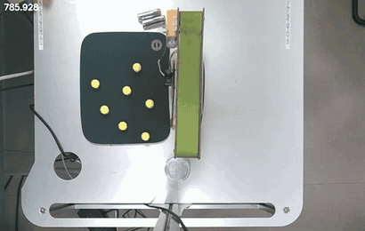
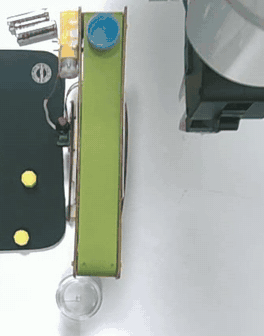
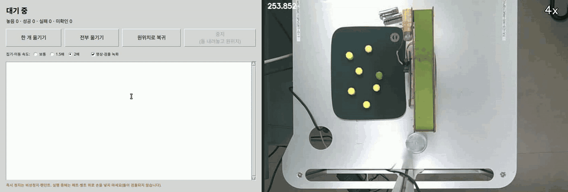
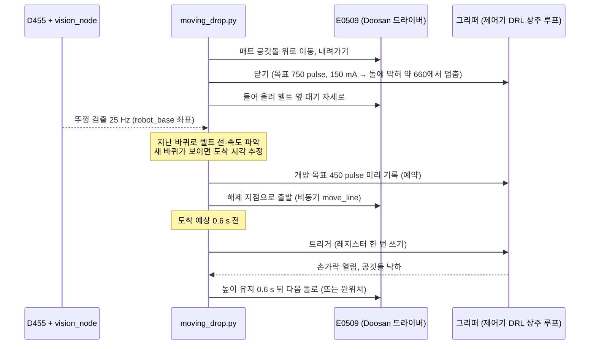
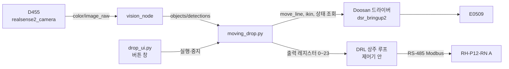
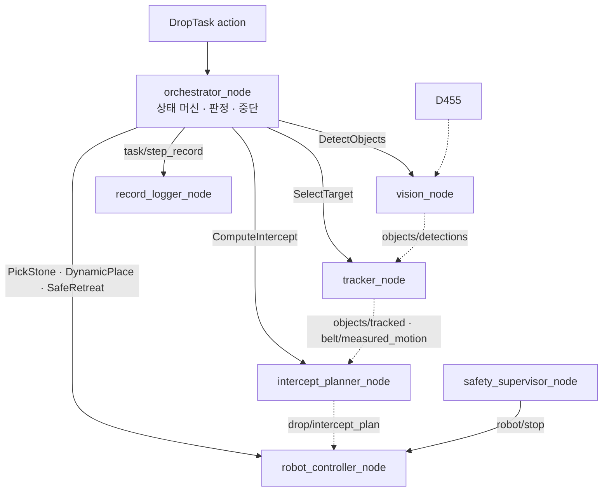

# conveyor-tracker-bot

**컨베이어 벨트 위를 지나가는 병뚜껑 안에 로봇팔이 공깃돌을 떨어뜨리는 프로젝트**입니다.
고정된 카메라 한 대로 뚜껑의 위치와 속도를 재고, 뚜껑이 해제 지점에 오는 시각을 예측해 그리퍼가 열리는 시간만큼 먼저 놓습니다.
벨트에는 엔코더가 없고, 로봇은 벨트를 따라 움직이지 않습니다.

- 로봇: Doosan **E0509** · 그리퍼: ROBOTIS **RH-P12-RN(A)** · 카메라: Intel RealSense **D455**(위에서 내려다봄)
- 소프트웨어: **ROS 2 Jazzy**, Python. 저장소 루트가 colcon 워크스페이스입니다.

## 시연

| 한 사이클 (4배속): 매트에서 집기 → 벨트 옆 대기 → 투입 | 투입 순간 (실제 속도) |
|---|---|
|  |  |

상단 카메라로 녹화한 영상입니다(왼쪽 위 숫자는 카메라 시각).

- [한 개 옮기기](media/one_stone.mp4) — 43 s, 벨트 약 35 mm/s
- [연속 모드로 두 개](media/two_stones_continuous.mp4) — 놓은 자리에서 원위치를 거치지 않고 다음 돌로 감, 벨트 약 51 mm/s
- [연속 모드로 다섯 개, 집기·이동 2배속](media/five_stones_continuous_2x.mp4) — 닿지 않는 돌 2개는 건너뜀, 벨트 약 55 mm/s

### 버튼 창(GUI) 사용 장면



왼쪽은 버튼 창, 오른쪽은 같은 실행의 상단 카메라 영상입니다. "전부 옮기기"(집기·이동 2배속)를 누르면 매트의 공깃돌을 차례로 집어 지나가는 뚜껑에 넣고, 진행 상황과 놓은 수·성공 수를 창에 보여 줍니다. 팔이 닿지 않는 돌 2개는 건너뛰고 원위치로 돌아옵니다.
14:14 실제 실행의 기록을 로봇 없이 버튼 창에 같은 시간 간격으로 다시 넣어 녹화한 사용 시뮬레이션입니다(GIF 8배속, [MP4 4배속](media/gui_move_all_4x.mp4)).

### 현장 결과 (2026-11-14)

| 항목 | 값 |
|---|---|
| 연속 성공 | 놓은 공깃돌 **30개가 모두 뚜껑 안에 들어감**(13:10~14:41, 실패 0) |
| 벨트 속도 | 33~56 mm/s (건전지 상태에 따라 바뀜) |
| 도착 시각 예측 오차 | −0.10 ~ +0.07 s (뚜껑이 실제로 해제 지점을 지난 시각 대비, 녹화 분석한 14회) |
| 뚜껑 안 공깃돌 위치 | 뚜껑 중심에서 x −3.9 ~ +1.0 mm, y −1.6 ~ +4.1 mm (허용 ±6.5 mm, 같은 14회) |
| 개방 신호 지연 | 계획 대비 3~8 ms |
| 공깃돌 하나에 걸린 시간 | 한 개씩 약 40 s, 연속 모드 약 21~23 s (벨트 두 바퀴) |

판정은 vision의 뚜껑 안 공깃돌 검출(`stone_inside`)로 하고, 녹화 영상으로도 확인했습니다.

## 어떻게 동작하나



**1. 뚜껑 보기.** `vision_node`가 1280×800 영상에서 파란 뚜껑과 공깃돌을 색·모양으로 찾고, 카메라 보정(hand-eye)과 벨트·매트 평면을 이용해 로봇 좌표(`robot_base`, m)로 바꿉니다. 뚜껑 안에 공깃돌이 있는지도 함께 냅니다.

**2. 도착 시각 예측.** 뚜껑은 벨트에 붙어 계속 돕니다. 직전 바퀴에서 잰 평균 속도와 지금 위치(최근 검출 5개의 중앙값)로 해제 지점 도착 시각을 계산합니다. 짧은 구간의 직선 맞춤보다 오차가 절반이었습니다(벨트 속도가 짧은 주기로 ±4 mm/s 흔들리기 때문). 벨트 속도가 바뀌면(직전 바퀴와 12 mm/s 이상 차이) 최근 1 s 직선 맞춤으로 바꿉니다. 롤러를 돌아 올라오는 구간(x < 0.56 m)은 속도를 따로 잡습니다.

**3. 미리 놓기.** 그리퍼는 제어기 플랜지의 RS-485로 연결되어 있어 PC가 직접 명령하지 못하고, 제어기에서 도는 DRL 프로그램(상주 루프)이 Modbus로 움직입니다. 개방 목표를 미리 써 두고 신호 한 번(레지스터 쓰기)으로 열어 지연을 줄였습니다. 손가락이 돌 폭보다 충분히 벌어지는 데 시간이 걸리므로, 뚜껑 도착 예상 **0.6 s 전**에 열고, 목표를 **450 pulse**로 크게 잡아 돌이 빠지는 구간을 빠르게 지나가게 했습니다(600 pulse로 열면 감속 구간 끝에서야 빠져 약 1.3 s가 걸렸습니다).

**4. 팔이 카메라를 가리지 않게.** 해제 지점 위에서 미리 기다리면 팔이 상류 벨트를 가려 뚜껑이 보이지 않습니다. 그래서 벨트 옆(y 0.16 m)에서 기다리다가 트리거 0.2 s 전에 해제 지점에 닿도록 출발하고, 팔이 해제 지점 50 mm 안에 들어온 뒤의 검출(그리퍼에 가려 중심이 밀림)은 예측에 쓰지 않습니다.

**5. 놓는 자리.** 해제 x는 0.675 m로 고정합니다(제어기 특이점 처리 때문에 x > 0.685 m에서는 팔이 목표에 정확히 닿지 않습니다). 뚜껑 중심이 0.670 m에 올 때 놓도록 시각을 맞춰, 공깃돌이 뚜껑 중심보다 5 mm 앞쪽에 떨어지게 했습니다. 해제 높이는 뚜껑 테두리 위로 플랜지 180.6 mm입니다.

**6. 판정과 안전.** 놓은 뒤 6 s 동안 뚜껑의 `stone_inside` 표시로 성공·실패를 판정합니다. 뚜껑을 못 잡거나 중지를 누르면 쥔 돌을 집었던 매트 자리에 내려놓고 원위치로 돌아갑니다.

## 구조

저장소에는 두 가지 실행 경로가 있습니다.

| 경로 | 무엇 | 실제 로봇 |
|---|---|---|
| **현장 투입 도구** `tools/robot/` | `moving_drop.py` + 버튼 창 `drop_ui.py`. vision 검출만 받아 로봇·그리퍼를 직접 움직임 | 위 결과를 낸 경로 |
| **ROS 2 파이프라인** `src/` | orchestrator가 단계별로 vision·tracking·planner·robot_controller 노드를 지휘하는 구조 | 대역(mock·fake)으로 한 사이클 전체를 시험. 로봇 연결 코드(Doosan backend)는 있으나 노드에 아직 연결하지 않음 |

### 현장 투입 도구



| 파일 | 역할 |
|---|---|
| `tools/robot/moving_drop.py` | 집기 → 대기 → 도착 시각 추정 → 접근 → 트리거 → 판정. `--count 0`이면 매트가 빌 때까지, 돌 사이에 원위치를 거치지 않음. 로봇 없이 `--execute` 없이 돌리면 계획과 예측 정확도만 확인 |
| `tools/robot/drop_ui.py`, `drop_ui.sh` | 버튼 창: 한 개 옮기기 / 전부 옮기기 / 원위치로 복귀 / 중지, 속도 1·1.5·2배, 녹화 선택 |
| `tools/robot/run_recorder.py` | 실행 중 상단 카메라 영상(mp4)·프레임 시각·검출 기록 |
| `tools/robot/drop_analyze.py` | 녹화 기록으로 성공·실패, 도착 시각 오차, 뚜껑 안 돌 위치를 계산하고 장면 모음 사진을 만듦 |
| `src/robot_control/robot_control/resident_transport.py`, `drl/gripper_resident.drl` | 그리퍼 상주 루프(DRL)와 PC 쪽 레지스터 통신 |
| `src/static_pick_place/` | 공깃돌 검출·자세 계획·Doosan 서비스 호출(정지한 뚜껑에 넣는 CLI `pick_place`도 포함) |

### ROS 2 파이프라인



실선은 명령(service·action), 점선은 데이터(topic)입니다. 명령은 orchestrator에서만 나가고, 로봇에 지령하는 노드는 `robot_controller_node` 하나입니다. 판단 로직은 ROS와 무관한 순수 Python 모듈에 두고 노드는 감싸기만 해서, 대부분을 ROS 없이 단위 시험합니다.

한 사이클의 단계: `PRECHECK → DETECT_STONE → PICK_STONE → MOVE_STANDBY → WAIT_CAP → PLAN_INTERCEPT → APPROACH → SYNCHRONIZE → DESCEND → RELEASE → RETREAT → VERIFY`. 단계마다 제한시간과 측정값 판정이 있고, 실패하면 중단 등급(L1~L4)에 따라 후퇴·정지합니다.

| 패키지 | 역할 |
|---|---|
| `drop_interfaces` | msg·srv·action 정의 |
| `vision` | 공깃돌·병뚜껑 검출, 픽셀 → 로봇 좌표, 뚜껑 안 공깃돌 판정 |
| `tracking` | 칼만 필터로 뚜껑 위치·속도, 벨트 속도 변화 검출 |
| `intercept_planner` | 시간 예산, 해제 시각·위치 계산 |
| `robot_control` | 로봇·그리퍼 지령(단위 변환, 그리퍼 어댑터, 상주 루프, 동적 투입 순서기, Doosan backend) |
| `orchestrator` | 사이클 진행·판정·중단, 안전 감시, 기록 |
| `calibration` | ChArUco 카메라 보정, 평면·hand-eye 보정, 고정 TF 발행 |
| `static_pick_place` | 정지한 뚜껑에 넣는 CLI와 Doosan 서비스 클라이언트 |
| `drop_mocks` | 실제 노드와 같은 인터페이스의 대역(시나리오 기반) |
| `drop_bringup` | launch 파일(카메라, 실시간 인식, 대역 전체, 재생)과 통합 시험 |
| `drop_sim` | 시뮬레이션 설정 자리 |

### 좌표계

```
world → robot_base (= base_link)
          ├─ conveyor_frame   x축 = 벨트 진행 방향
          ├─ mat_frame
          └─ camera_link → camera_color_optical_frame   (hand-eye 보정 결과)
```

거리는 m, 각도는 rad, 시각은 s입니다. Doosan 단위(mm, deg, ZYZ)와 그리퍼 pulse로 바꾸는 일은 `robot_control/motion_adapter.py`, `gripper_adapter.py`에서만 합니다. 현장 배치에서 벨트는 `robot_base` +x 방향으로 움직이고, 뚜껑이 지나가는 선은 y ≈ 0.085 m입니다.

### 디렉터리

```
config/              현장 설정: site.yaml, vision_node.yaml, calib/(카메라 외부 변환, 매트·벨트 평면)
src/                 ROS 2 패키지 11개
tools/robot/         현장 투입 도구(moving_drop, 버튼 창, 녹화·분석)
tools/bench/         장비 점검·측정(카메라, 그리퍼, 스트림 지령, 정지 시간)
tools/eval/          rosbag 녹화, 사이클 시간·통계, 시도 기록 스키마
tools/checks/        저장소 규약 검사(인터페이스, QoS, 노드 종료 처리, TF 사용 범위)
tools/testing/       공통 pytest 설정과 노드 계약 시험
Hand-Eye-Calibration/  ROS 없이 도는 hand-eye 보정 CLI
media/               시연 영상
```

## 설치

필요한 것: Ubuntu 24.04, ROS 2 Jazzy, [doosan-robot2](https://github.com/doosan-robotics/doosan-robot2)(jazzy, `dsr_msgs2`·`dsr_bringup2`), realsense-ros 4.58 이상, Python 패키지 numpy·opencv·pyyaml. 그리퍼 RH-P12-RN(A) 펌웨어 V12 이상(Modbus-RTU), E0509 플랜지 RS-485에 연결.

```bash
source /opt/ros/jazzy/setup.bash
source ~/ros2_ws/install/setup.bash          # doosan-robot2 워크스페이스
cd conveyor-tracker-bot
colcon build --symlink-install
source install/setup.bash
```

1280×800 영상을 받는 모든 노드와 셸은 같은 FastDDS 프로파일을 씁니다.

```bash
export ROS_DOMAIN_ID=40 ROS_AUTOMATIC_DISCOVERY_RANGE=LOCALHOST
export FASTRTPS_DEFAULT_PROFILES_FILE=$PWD/src/drop_bringup/config/fastdds_large_shm.xml
```

## 실행 (실제 로봇)

> 실제 로봇과 그리퍼가 움직입니다. 비상정지 버튼을 쥔 사람이 옆에 있을 때만 실행하세요.

터미널마다 위의 `source`와 `export`를 먼저 합니다.

```bash
# 1. 로봇 드라이버
ros2 launch dsr_bringup2 dsr_bringup2_rviz.launch.py mode:=real host:=<제어기 IP> model:=e0509 gui:=false

# 2. 카메라
ros2 launch drop_bringup camera.launch.py enable_depth:=false

# 3. 실시간 인식(vision·tracker·planner, RViz)
ros2 launch drop_bringup replay.launch.py use_sim_time:=false rviz:=true vision_params_file:=config/vision_node.yaml

# 4. 버튼 창
tools/robot/drop_ui.sh
```

버튼 창([사용 장면](#버튼-창gui-사용-장면)):

| 버튼 | 동작 |
|---|---|
| 한 개 옮기기 | 매트에서 가장 가까운(팔이 닿는) 공깃돌 하나를 집어 지나가는 뚜껑에 넣고 원위치 |
| 전부 옮기기 | 매트가 빌 때까지 반복. 놓은 자리에서 바로 다음 돌로 감 |
| 원위치로 복귀 | 이동 높이로 올린 뒤 원위치(x 0.373, y 0, z 0.405 m) |
| 중지 | 다음 결정 지점에서 멈춤. 해제 지점으로 이미 출발했으면 그 돌까지 놓고, 기다리는 중이면 쥔 돌을 매트에 내려놓은 뒤 원위치 |

속도(1·1.5·2배)는 집기·이동 구간에만 적용됩니다. 녹화를 켜면 `logs/<날짜>/`에 영상·검출·실행 기록이 남습니다. 중지 버튼은 움직이는 팔을 바로 세우지 않습니다. 즉시 정지는 비상정지 버튼으로 합니다.

명령줄로도 실행할 수 있습니다.

```bash
export PYTHONPATH=$PWD:$PYTHONPATH
python3 tools/robot/moving_drop.py --config config/site.yaml                         # 계획만(로봇 지령 없음)
python3 tools/robot/moving_drop.py --config config/site.yaml --execute               # 한 개
python3 tools/robot/moving_drop.py --config config/site.yaml --execute --count 0     # 전부
python3 tools/robot/moving_drop.py --config config/site.yaml --execute --record logs/run-01 > logs/run-01.jsonl
python3 tools/robot/drop_analyze.py logs/run-01                                      # 녹화 판정·장면 모음
```

주요 옵션: `--drop-delay-s`(트리거를 도착보다 얼마나 먼저, 기본 0.6), `--release-open-pulse`(기본 450), `--x-offset-m`(기본 0.005), `--rel-x`(기본 0.670), `--speed-scale`.

## 실행 (로봇 없이)

```bash
# 전체 파이프라인을 대역으로: 시나리오 기반 mock 세계·로봇
ros2 launch drop_bringup mock.launch.py

# 녹화한 rosbag으로 인식만 재생
ros2 launch drop_bringup replay.launch.py bag:=<bag 폴더> vision_params_file:=config/vision_node.yaml rviz:=true
```

## 시험

```bash
colcon build --symlink-install && source install/setup.bash
python3 -m pytest tools -m "not realtime_pc"
for pkg in orchestrator robot_control calibration tracking intercept_planner vision static_pick_place drop_mocks drop_bringup; do
  python3 -m pytest src/$pkg/test -m "not realtime_pc"
done
```

시험은 실제 장비 없이 돕니다. ROS 노드를 띄우는 시험은 다른 실행과 섞이지 않게 `ROS_DOMAIN_ID`를 따로 주세요. `realtime_pc` 표시가 붙은 시험은 10 Hz·100 Hz 주기에 의존해 공유 CI에서는 참고로만 봅니다.

## 현장 설정과 한계

- **보정값**: `config/calib/`의 카메라 외부 변환과 평면은 이 현장 배치(카메라·벨트·매트 위치)에서 잰 값입니다. 장비를 옮기면 `calibration` 패키지와 `Hand-Eye-Calibration/`으로 다시 잽니다.
- **해제 위치**: x는 0.685 m 이하만 씁니다(그보다 멀면 제어기 특이점 처리로 경로가 틀어짐).
- **벨트 속도**: 뚜껑이 처음 보인 뒤 도착까지 약 2.0 s가 필요합니다. 벨트가 약 58 mm/s보다 빠르면 접근이 늦어 통과를 보냅니다.
- **뚜껑 하나**: 벨트에 뚜껑이 하나라 놓는 간격은 벨트 바퀴 수의 배수입니다(연속 모드에서 두 바퀴에 하나).
- **검출**: 사람 손이 매트 위에 있으면 공깃돌이 검출되지 않습니다. 매트와 벨트 사이의 빨간 LED는 공깃돌로 잘못 잡힐 수 있어 y > 0.02 m의 매트 검출은 버립니다. 초록 공깃돌은 뚜껑 안 판정이 흔들릴 수 있습니다.
- **그리퍼**: 파지 전류는 150 mA, 동작 범위는 0~750 pulse입니다. 그리퍼 펌웨어와 통신 설정(Protocol, ID, 통신 속도)은 바꾸지 않습니다.
- **tracker 좌표**: `tracking.yaml`의 `T_base_conveyor`는 이 현장 배치로 보정하지 않았습니다. 실시간 인식을 띄우면 tracker가 "관측 구간 밖 검출" 경고를 냅니다. 현장 투입 도구는 tracker를 쓰지 않으므로 동작에는 영향이 없습니다.
- **ROS 2 파이프라인**: 대역 시험에서는 한 사이클 전체가 돌지만, 실제 로봇은 아직 이 경로로 움직이지 않았습니다(Doosan backend를 `robot_controller_node`에 연결하는 일이 남음).

## Collaborator

<div align="center">
<table>
  <tr>
    <td align="center" width="25%">
      <a href="https://github.com/chhowm"></a>
      <h3>황치영</h3>
      <a href="https://github.com/chhowm"></a>
    </td>
    <td align="center" width="25%">
      <a href="https://github.com/denny1105kim"></a>
      <h3>김재현</h3>
      <a href="https://github.com/denny1105kim"></a>
    </td>
    <td align="center" width="25%">
      <a href="https://github.com/konor123"></a>
      <h3>주권호</h3>
      <a href="https://github.com/konor123"></a>
    </td>
    <td align="center" width="25%">
      <a href="https://github.com/fmv3654"></a>
      <h3>김동준</h3>
      <a href="https://github.com/fmv3654"></a>
    </td>
  </tr>
</table>
</div>
