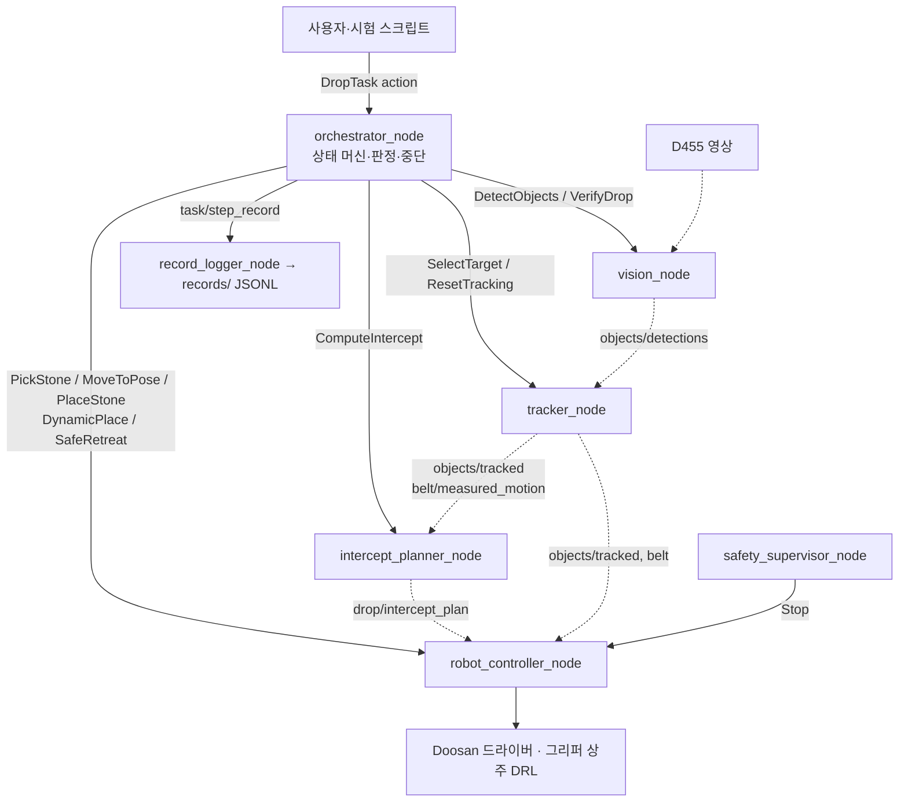
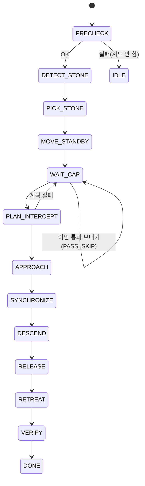

# 전체 코드 설명: 움직이는 병뚜껑에 공깃돌 넣기 (2026-11-14)

이 문서는 저장소 전체 코드를 처음 보는 사람이 구조를 이해하고 발표할 수 있도록 설명한다. 기준은 커밋 `f654f62`(2026-11-14 14:19 KST)이며, 이 문서의 수치는 그 커밋의 코드·설정 파일과 기록에서 옮겼다. 코드가 바뀌면 수치도 바뀔 수 있으니 발표 직전에 링크한 원본을 한 번 더 본다.

- 설계 원본: [PLAN](../../PLAN.md) / 진행·게이트: [Progress](../../Progress.md) / 시험 명세: [TEST_SPEC](../../TEST_SPEC.md) / 요구사항: [specs](../../specs/)
- 낯선 말은 [용어집](glossary.md)을 함께 펼친다. 개별 주제의 깊은 설명은 각 절 끝의 학습 문서 링크를 따라간다.

## 1. 한 장 요약

**무엇을 하나.** 소형 컨베이어 벨트에 붙은 병뚜껑이 계속 돌아간다. 고정된 카메라가 뚜껑의 위치와 속도를 재고, Doosan E0509 로봇팔이 매트 위 공깃돌을 집어 지나가는 뚜껑 안에 떨어뜨린다.

| 항목 | 값 | 출처 |
|---|---|---|
| 병뚜껑 | 안지름 31 mm, 바깥지름 32 mm, 테두리 높이 벨트면 위 22 mm | Progress.md 0절 |
| 공깃돌 | 팔각기둥, 지름 17~18 mm, 높이 15 mm | Progress.md 0절 |
| 허용 중심 오차 `e_xy_max` | 3.25 mm = 0.5 × (31 − 18) / 2 | `src/orchestrator/config/orchestrator.yaml` `sync.e_xy_max_m` |
| 벨트 | 길이 약 570 mm, 평균 23.8~127.0 mm/s(11-07 측정), 11-14에는 건전지 상태에 따라 17~56 mm/s | `records/bench/belt-video-2026-11-07/README.md`, `records/sessions/OFF-2-2026-11-14.md` |
| 장비 | E0509 로봇, RH-P12-RN(A) 그리퍼(제어기 플랜지 RS-485, 제어기 DRL이 통신), RealSense D455 상단 고정 | README.md |
| 소프트웨어 | ROS 2 Jazzy, 저장소 루트가 colcon 워크스페이스, 패키지 11개 | `src/` |

**핵심 생각.** 벨트에 엔코더가 없다. 카메라 영상만으로 뚜껑의 위치·속도를 추정하고(칼만 필터), 뚜껑이 해제 지점에 오는 시각을 예측해 팔을 미리 보내고, 그리퍼가 열리는 데 걸리는 시간만큼 앞서 연다.

**지금 어디까지 왔나(2026-11-14 14:19 기준).**

- 정식 경로(orchestrator → 기능 노드 → `robot_controller_node`)는 대역(mock·fake)으로 PC와 CI에서 한 사이클을 끝까지 돈다. 실제 로봇을 움직이는 Doosan 연결 코드는 작성했지만 `robot_controller_node`에는 아직 연결하지 않았다. 그래서 **정식 경로로 실제 로봇을 움직인 적은 없다.**
- 현장에서는 정지한 뚜껑에 넣기(G2)를 2026-11-09에 성공했고 사용자 판정으로 통과했다(2026-11-11).
- 2026-11-14에는 정식 경로가 아닌 **간이 스크립트**(`records/patches/2026-11-14-g4-simple-demo.patch`, `main`에 미반영)로 움직이는 뚜껑에 놓은 돌 **26개가 연속으로 들어갔다**(13:10~14:14). 같은 뚜껑 하나, 같은 해제 지점, 벨트 33~56 mm/s다. 현장 세션이 계속 진행 중이므로 발표 직전에 `records/sessions/OFF-2-2026-11-14.md`의 최신 수치를 확인한다. 정식 G4 합격 기준(저속 30회, 예측 오차 p95)은 측정하지 않았다.

## 2. 상태표: 코드, PC·CI 시험, 실기 확인은 서로 다른 증거다

| 게이트 | 목표 | 코드 | PC·CI 시험 | 실제 장비 | 게이트 판정 |
|---|---|---|---|---|---|
| M0 | 명세·인터페이스·오케스트레이터 골격·대역 | 있음 | 통과(CI, 대역 I0) | 해당 없음 | 통과 2026-11-11 (`records/gates/gate-M0-report-2026-11-11.md`) |
| G0 | 로봇·그리퍼 제어 계약 | 단위 변환·그리퍼 어댑터·상주 루프 DRL·Doosan backend(미연결) | 단위·대역 시험 통과 | 11-07 스트림 측정, 11-14 상주 루프 기동·레지스터 0~23·상위 바이트 쓰기 확인, 루프 중 `move_line`·speedl 수락 | 미판정. 스트림 중 그리퍼 개방, `move_stop` 정지, pulse↔간격 실측표, backend 연결이 남음 |
| G1 | 검출·보정 | `vision`, `calibration` | 통과 | 11-07 보정, 정지 투입 목표 좌표 획득 | 수치 기준(검증 점 p95 ≤ 1 mm 등) 미측정 |
| G2 | 정지 뚜껑 투입 | `static_pick_place` CLI | 통과 | 11-09 성공, 11-14 2회 중 1회 성공 | 사용자 판정 통과 2026-11-11 |
| G3 | 추적·속도 추정 | `tracking` | 통과 | 11-13 실시간 추적 사전 확인(측정 아님) | 독립 GT 대비 오차 미측정 |
| G4 | 예측 타이밍 투입 | `intercept_planner`, `DynamicPlace`(fake transport) | 대역 I0 통과 | 정식 경로 미시도. 간이 스크립트로 26개 연속 성공(11-14) | 미측정 |
| G5 | 비접촉 동기 추종 | `belt_sync`, `tracking_command` | 단위 통과 | 미시도 | 미측정 |
| G6·G7 | 동적 투입·통합 100회 | 일부 | 일부 | 미시도 | 미측정 |

발표에서 "됐다"고 말할 때는 이 표의 칸을 구분한다. "PC 시험 통과"는 실기 성공이 아니고, "간이 스크립트 성공"은 정식 경로 G4 통과가 아니다.

## 3. 시스템 구조

### 3.1 명령은 별, 데이터는 파이프라인



실선은 명령(service·action), 점선은 데이터(topic)다. 이 그림이 프로젝트의 지휘 규칙([PLAN 2.2절](../../PLAN.md))을 그대로 보여 준다.

1. **명령은 orchestrator에서만 나간다.** 기능 노드끼리 서로의 service·action을 부르지 않는다. 기능 노드는 작업 순서를 모른다.
2. **연속 데이터는 topic으로 흐른다.** `detections → tracked → intercept_plan`은 기능 노드 사이에서 직접 주고받는다.
3. **로봇에 지령하는 주체는 `robot_controller_node` 하나다.** 감시 노드도 로봇에 직접 지령하지 않고 `robot/stop` 서비스를 부른다.
4. **모든 요청에 `cycle_id`·`step_id`·`deadline`이 들어간다.** 서버도 deadline이 지나면 스스로 `TIMEOUT`으로 끝낸다(이중 제한시간).
5. **기능 노드는 lifecycle 노드다.** 시작 전 점검(PRECHECK)에서 모두 `ACTIVE`인지 본다.
6. **필터는 tracker에서 한 번만 쓴다.** planner는 예측만 하고 다시 거르지 않는다.
7. **판단은 ROS와 무관한 순수 Python 모듈에 두고, 노드는 감싸기만 한다.** 그래서 대부분의 판단을 ROS 없이 단위 시험할 수 있다.

### 3.2 패키지 11개

| 패키지 | 한 줄 역할 | 핵심 파일 |
|---|---|---|
| `drop_interfaces` | msg 10·srv 6·action 6 정의 | `msg/`, `srv/`, `action/` |
| `vision` | 공깃돌·병뚜껑 검출, 픽셀 → 로봇 좌표 | `detector.py`, `localizer.py`, `pipeline.py`, `vision_node.py` |
| `tracking` | 칼만 필터로 뚜껑 위치·속도, 벨트 속도 변화 검출 | `kalman.py`, `track_manager.py`, `tracker_node.py` |
| `intercept_planner` | 시간 예산, 해제 시각·위치 계산 | `time_budget.py`, `intercept.py`, `plan_session.py` |
| `robot_control` | 로봇·그리퍼 지령의 유일한 주체 | `robot_controller_node.py`, `skill_logic.py`, `dynamic_place.py`, `gripper_adapter.py` |
| `orchestrator` | 사이클 진행·판정·중단, 안전 감시, 기록 | `cycle_runner.py`, `state_machine.py`, `step_judges.py`, `abort_policy.py` |
| `calibration` | 카메라·평면·hand-eye 보정, 고정 TF | `charuco.py`, `plane_calibration.py`, `eye_to_hand_calibration.py`, `static_frames.py` |
| `drop_mocks` | 실제 노드와 같은 인터페이스의 대역(시나리오 기반) | `scenario_engine.py`, `mock_world_node.py`, `mock_robot_controller_node.py` |
| `drop_bringup` | launch 파일과 통합 시험 | `drop.launch.py`, `mock.launch.py`, `replay.launch.py`, `camera.launch.py` |
| `static_pick_place` | 현장 정지 투입 CLI(G2에 쓴 도구) | `pick_place.py`, `plan.py`, `doosan_client.py` |
| `drop_sim` | Isaac Sim 자리(설정 파일만, 장면 없음) | `config/simulation.yaml` |

저장소 루트의 `Hand-Eye-Calibration/`은 ROS 없이 도는 별도 hand-eye 보정 CLI(ArUco 표식 + 로봇 자세)이고, `tools/`는 현장 측정·분석·추적 행렬 도구다(8절).

### 3.3 노드와 토픽 한눈에

| 노드 | 받는 것 | 내는 것 | 제공하는 명령 인터페이스 |
|---|---|---|---|
| `vision_node` | `camera/color/image_raw` | `objects/detections`, heartbeat | `vision/detect_objects` |
| `tracker_node` | `objects/detections` | `objects/tracked`, `belt/measured_motion`, `/tf`(`conveyor_frame → cap_<id>`), heartbeat | `tracking/select_target`, `tracking/reset` |
| `intercept_planner_node` | `objects/tracked` | `drop/intercept_plan`, `drop/predicted_marker`(RViz), heartbeat | `planner/compute_intercept` |
| `robot_controller_node` | `drop/intercept_plan`, `objects/tracked`, `belt/measured_motion` | `robot/status`, heartbeat | action `robot/pick_stone`·`move_to_pose`·`place_stone`·`dynamic_place`·`safe_retreat`, service `robot/stop` |
| `orchestrator_node` | heartbeat, `robot/status`, belt, tracked, detections | `task/status`, `task/step_record` | action `drop_task`(외부 진입점) |
| `safety_supervisor_node` | heartbeat, `robot/status`, `task/status` | `robot/stop` 호출 | — |
| `record_logger_node` | `task/step_record` | `records/` JSONL | — |

모든 기능 노드는 0.1 s마다 `system/heartbeat`를 낸다. heartbeat 타이머는 ROS 시각이 멈추거나 거꾸로 가도 돌도록 steady 시계를 쓴다.

### 3.4 좌표계(TF)

```
world → robot_base(= base_link)
          ├─ conveyor_frame   x축 = 벨트 진행 방향 (static_frames_publisher)
          │     └─ cap_<id>   tracker가 관측 시각으로 발행
          ├─ mat_frame        (static_frames_publisher)
          └─ camera_link → camera_color_optical_frame   (camera_tf_publisher, 보정 결과)
```

모든 거리는 `robot_base` 기준 m, 각도는 rad, 시각은 초다. Doosan 단위(mm, deg, ZYZ 오일러)로 바꾸는 일은 `robot_control/motion_adapter.py`, 그리퍼 pulse로 바꾸는 일은 `gripper_adapter.py`에서만 한다. 미래 위치는 TF로 내지 않고 planner가 계산한다(tf2는 외삽하지 않는다). 자세한 설명: [고정 좌표계 TF와 RViz](2026-11-11-static-frames-and-rviz.md).

## 4. 한 사이클 따라가기

`DropTask` goal 하나가 사이클 하나다. goal에는 `mode`(STATIC 0 / PREDICTED 1 / SYNCHRONIZED 2), `max_belt_speed`, `timeout`, `max_passes`가 들어간다.

### 4.1 상태 흐름



이 전이 규칙은 `src/orchestrator/orchestrator/state_machine.py` 한 파일(43줄)의 `next_state()`가 전부다. STATIC 모드는 PLAN_INTERCEPT·SYNCHRONIZE를 뺀 순서를 쓴다. 어느 단계에서든 중단 등급이 정해지면 중단 상태(ABORT_CYCLE·SAFE_ABORT·PROTECTIVE_STOP)를 거쳐 WAIT_OPERATOR로 간다(6절).

### 4.2 단계마다 누가 무엇을 하나 (MODE_PREDICTED 기준)

실행기는 `cycle_runner.py`의 `CycleRunner`다. 단계마다 `_do_<단계>()`가 `SkillPort`(ROS service·action 클라이언트를 감싼 포트)를 부르고, 돌아온 **측정값**을 `step_judges.py`의 순수 함수로 판정한다. "skill이 오류 없이 끝났다"만으로는 성공이 아니다.

| 단계 | orchestrator가 부르는 것 → 처리하는 곳 | 성공 판정(설정값) | 제한시간 | 실패 시 |
|---|---|---|---|---|
| PRECHECK | 캐시한 heartbeat·lifecycle·`robot/status` | 모든 노드 ACTIVE, heartbeat 0.3 s 이내, 로봇 준비, 벨트 속도 ≤ `max_belt_speed` | 5 s | 시도하지 않고 IDLE(`NOT_ATTEMPTED`) |
| DETECT_STONE | `vision/detect_objects` → `vision_node` 안정 창 | 신뢰도 ≥ 0.9, 창 안 위치 표준편차 ≤ 0.5 mm | 3 s | L2 |
| PICK_STONE | `robot/pick_stone` → `skill_logic.StaticSkillExecutor.pick_stone` | 검출 1 s 이내, 핑거 간격 17~18 mm ± 1 mm, 전류 ≥ 100 mA | 15 s | L2 |
| MOVE_STANDBY | `robot/move_to_pose`(`standby`) | 자세 오차 ≤ 2 mm | 10 s | L3(돌을 쥐고 있음) |
| WAIT_CAP | `tracking/select_target` → 이후 새 관측마다 판정 | 관측 ≥ 30회, 속도 표준편차 ≤ 1 mm/s, 시간 여유 ≥ 1.0 s, 도달 구간 진입 3.0 s 전 | 30 s × (`max_passes` + 1) | 통과 보내기, 다 쓰면 L3(`NOT_ATTEMPTED`) |
| PLAN_INTERCEPT | `planner/compute_intercept` → `intercept.compute_plan` | 상태 OK, 여유 ≥ 1.0 s, 위치 표준편차 ≤ 3.25 mm | 0.5 s | 이번 통과 보내기 |
| APPROACH | `robot/dynamic_place` goal 하나가 APPROACH~RETREAT를 수행 | 해제점 위 도달 오차 ≤ 2 mm | 3 s | L3 |
| SYNCHRONIZE | 같은 goal의 feedback | PREDICTED: 진입 시각 오차 ≤ 0.05 s, 상대 속도 ≤ 5 mm/s / SYNCHRONIZED: `e_xy` ≤ 3.25 mm·상대 속도 ≤ 5 mm/s가 0.3 s 유지 | 2 s | L3 |
| DESCEND | feedback | 해제 높이 ± 0.5 mm, 테두리 위 여유 ≥ 2 mm | 1.5 s | L3 |
| RELEASE | controller 안의 해제 게이트 → 그리퍼 개방 | 개방 폭 ≥ 18 mm + 4 mm − 1 mm, 동기 유지 | 2.0 s | 되돌릴 수 없으므로 후퇴·검증 계속 |
| RETREAT | feedback | TCP z ≥ 0.10 m, 그리퍼에 돌 없음, 작업영역 밖 | 3 s | L4(후퇴 실패는 기계 이상) |
| VERIFY | `vision/verify_drop` | SUCCESS 또는 UNKNOWN | 3 s | UNKNOWN으로 기록 |

수치 출처는 `src/orchestrator/config/orchestrator.yaml`이다. 대부분 `TBD(측정 G0)`가 붙은 제안값이며, 실측으로 바꾸면 `records/param_changes.csv`에 근거를 남긴다.

알아둘 점:

- **제한시간은 셋 중 가장 이른 것이다.** `deadlines.effective_deadline()` = min(지금 + 단계 제한시간, 동적 deadline, 사이클 deadline). 동적 deadline은 "뚜껑이 도달 구간을 빠져나가기 전 후퇴 여유를 남긴 시각"이다.
- **DynamicPlace는 goal 하나로 다섯 단계를 한다.** orchestrator는 단계마다 새 goal을 보내지 않고 feedback의 `phase_done`을 보고 단계를 판정한다(`_place_goal_deadline()`이 goal 전체 상한을 단계 제한시간의 합으로 준다).
- **해제는 controller가 결정한다.** 그리퍼를 열지 말지는 `robot_controller_node` 안의 해제 게이트가 판정한다(5.4절). orchestrator는 열린 결과를 판정할 뿐이다.
- **실제 `vision_node`는 아직 `vision/verify_drop`을 제공하지 않는다.** 판정 함수(`vision/verifier.py`)는 있지만 노드에 연결되지 않았고, 이 서비스는 대역(`mock_world_node`)만 제공한다. 실제 노드로 돌리면 VERIFY는 UNKNOWN으로 기록된다. 성공률은 관찰자 판독으로 센다(PLAN 4.5절).

## 5. 패키지별 설명

### 5.1 `drop_interfaces`: 계약의 원본

모든 요청에 공통 필드(`cycle_id`, `step_id`, `deadline`)가, 모든 결과에 공통 결과 코드(OK 0, FAILED 1, TIMEOUT 2, PRECONDITION 3, CANCELED 4, FAULT 5)가 들어간다. 중요한 메시지:

- `ObjectDetection`: 픽셀 중심·지름, 신뢰도, `robot_base` 위치와 3×3 공분산, `position_valid`, 뚜껑이면 `stone_inside`(안에 돌이 있나)와 `stone_inside_valid`(판정 가능한가).
- `TrackedObject`: `track_id`, `epoch`(리셋·재시작마다 증가, 옛 계획 무효화), 상태 `OBSERVED/COASTING/LOST`, 위치·속도·4×4 공분산, `valid_until`.
- `InterceptPlan`: `plan_id`, `revision`, 대상 track·epoch, `release_time`, `valid_until`, 해제 직전 TCP 자세, 목표 속도, 위치 표준편차, 시간 여유, 상태(OK / TIME_INSUFFICIENT / UNREACHABLE / UNCERTAIN / EXPIRED).
- `DynamicPlace.action`: 해제 게이트 임계값(`e_xy_max`, `v_rel_max`, `tau_max`, `position_std_max`, `rim_clearance`)과 개방 폭을 goal로 받는다.

인터페이스를 바꾸면 SPEC-010 버전을 올리고 `tools/spec/snapshot_interfaces.sh`로 스냅샷을 갱신한다(CI가 비교).

### 5.2 `vision`: 픽셀에서 로봇 좌표까지

한 프레임의 처리 순서(`pipeline.process_frame`):

1. **ROI별 검출**(`detector.detect`). 매트 ROI에서는 공깃돌만, 벨트 ROI에서는 뚜껑과 공깃돌을 찾는다. ROI를 감싸는 사각형 + 여유만 잘라 계산한다(REQ-VIS-011).
   - 공깃돌은 면마다 색이 달라(노랑·분홍·보라·빨강·파랑) 색 범위 대신 **ROI 배경색과의 Lab 거리**로 찾는다.
   - 뚜껑은 HSV 색 범위 마스크 + 구멍 채움 + 원형도 필터, 고리가 끊기면 원 적합(Kasa 최소제곱)으로 바깥 원을 구한다.
   - 중심은 경계 픽셀에 배경 거리 비율로 가중치를 준 **서브픽셀 중심**이다.
   - 뚜껑 원 안(지름 × 0.80)에 공깃돌 중심이 있으면 `stone_inside`.
2. **광선-평면 교차**(`localizer.pixel_to_plane`). 왜곡 보정한 픽셀에서 카메라 광선을 만들고 대상물 높이의 평면과 만나는 점을 구한다. 공깃돌은 매트 평면 + 돌 높이, 뚜껑은 벨트 평면 + 테두리 높이를 쓴다. 픽셀 중심의 불확실성은 야코비안으로 3×3 위치 공분산까지 전파한다.
3. **안정 창**(`stable_window.DetectionWindow`). `DetectObjects` 서비스는 최근 프레임을 모아, 창 안에서 80% 이상 보이고 흔들림(표준편차)이 작은 대상만 돌려준다.

`vision_node`는 처리 중이면 **가장 최근 프레임 하나만** 남긴다(밀린 영상을 쌓지 않음). 현장 높이·보정 경로는 기본 `vision.yaml`이 아니라 현장 파라미터 파일(`vision_params_file`, 예: `records/calib/2026-11-09-planes/vision_node.yaml`)로 덮어쓴다. 기본 `vision.yaml`의 `h_rim_m` 0.006은 가정값이고 실측은 0.022다.

더 읽기: [공깃돌·병뚜껑 검출과 좌표](2026-11-09-stone-cap-detection.md), [ROI 잘라 계산](2026-11-14-review-synthesis-roi-crop-tracker-liveness.md), [카메라 QoS](2026-11-09-camera-qos-and-event-phase-test.md).

### 5.3 `tracking`: 뚜껑 위치·속도와 벨트 속도

`TrackManager.process_frame()`이 프레임마다 하는 일:

1. 시각이 거꾸로 온 프레임은 버린다.
2. 모든 track을 이번 프레임 시각까지 **예측**(`KalmanCV.predict`, 상태 `[x, y, vx, vy]`, 등속 모델, 가속 잡음 0.01 m/s²).
3. 관측 구간 끝을 넘었거나 1.0 s 넘게 안 보인 track은 LOST.
4. 검출과 track을 **마할라노비스 거리 게이트**(χ² 100)로 탐욕적으로 짝짓는다(`association.associate`).
5. 짝이 된 track은 칼만 **갱신**(Joseph 형식 공분산), 못 찾은 track은 1.0 s까지 COASTING.
6. 관측 구간(x −0.35~0.35 m) 안의 새 검출만 새 track을 만든다. 초기 속도는 지금 벨트 속도 추정값.
7. 가장 많이 관측된 track으로 벨트 속도(`BeltMotion`)를 추정한다.
8. 진행 방향 혁신값의 **양방향 CUSUM**(k 2, h 16)으로 다이얼을 돌린 속도 변화를 잡아 `steady=false`를 낸다. 실제 벨트의 맥동에는 거의 울리지 않고 20 mm/s 이상 계단은 1 s 안에 잡도록 11-07 벨트 영상으로 정했다.

`tracker_node`는 검출 메시지가 올 때마다 결과를 내고, 입력이 0.2 s 넘게 끊기면 1/30 s마다 빈 프레임을 합성해 track이 늙게(COASTING → LOST) 한다. ROS 시각이 거꾸로 가면 track을 모두 지우고 epoch를 올린다. 설정: `src/tracking/config/tracking.yaml`.

더 읽기: [움직이는 병뚜껑 추적과 해제 계획](2026-11-09-tracking-and-intercept-planning.md), [현장 점검: 실시간 추적이 멈춘 이유](2026-11-13-site-check-camera-and-live-tracking.md).

### 5.4 `intercept_planner`: 언제, 어디서 놓을까

`intercept.compute_plan()`의 계산:

1. 요청 검증: 모드(PREDICTED·SYNCHRONIZED만), epoch 일치, track 존재.
2. **시간 예산**(`time_budget.evaluate_budget`): `T_available` = (도달 구간 끝 `x_exit` − 뚜껑 x) ÷ 속도, `T_required` = 이동 1.5 + 동기 0.5 + 하강 0.8 + 해제 0.3 + 이탈 0.9 = 4.0 s. 여유가 1.0 s보다 작으면 TIME_INSUFFICIENT. 벨트가 멈추거나 거꾸로 가면 바로 실패.
3. **해제 시각** = max(지금 + 이동·동기·하강 시간, 요청한 가장 이른 시각, 뚜껑이 도달 구간에 들어오는 시각).
4. **해제 위치** = 그 시각의 예측 위치 `p + v·(t − t_state)`를 `robot_base`로 바꾸고, z는 테두리 위 0.1656 m(플랜지 기준, 해제 높이).
5. 도달 범위·작업영역 밖이면 UNREACHABLE, 예측 표준편차가 3.25 mm를 넘으면 UNCERTAIN.

`PlanSession`은 노드 수명 동안 `plan_id`를 관리한다. `ComputeIntercept`가 계획을 처음 만들면(`revision` 1), 그 뒤 새 `objects/tracked`가 올 때마다 **해제 시각은 고정한 채** 최신 track 상태로 해제 위치를 다시 계산해 `revision`을 올려 발행한다. 0.02 s 타이머는 계획 만료·epoch 불일치·track 손실을 확인해 계획을 EXPIRED로 닫는다. 설정: `src/intercept_planner/config/planner.yaml`.

### 5.5 `robot_control`: 로봇·그리퍼 지령의 유일한 주체

이 패키지는 판단 모듈과 연결(transport) 모듈로 나뉜다.

**판단(순수 Python)**

- `skill_logic.StaticSkillExecutor`: MoveToPose·PickStone·PlaceStone·SafeRetreat의 순서와 판정. 성공은 backend가 돌려준 **측정값**(도착한 TCP, 그리퍼 폭·전류)으로만 판정한다. 동시에 두 goal을 받지 않는다(`SingleCommandAuthority`, Stop만 선점 가능).
- `dynamic_place.DynamicPlaceSequencer`: APPROACH → SYNCHRONIZE → DESCEND → RELEASE → RETREAT. 0.01 s마다 `tick()`. goal의 `plan_id`·`epoch`와 맞는 계획만 받고, 이미 받은 revision 이하는 버린다. epoch가 바뀌거나 계획이 만료되면 `PLAN_INVALID`로 끝낸다.
- `dynamic_place.release_gate()`: 그리퍼를 열기 직전 한 번, 그리퍼가 실제로 열리는 데 걸리는 시간(`commit_lead_s`)만큼 앞으로 외삽한 "해제 순간"의 예측으로 판정한다. 조건 13개를 아래 순서로 보고 처음 걸린 것을 이유로 낸다. 하나라도 걸리면 열지 않는다.
  - 값 자체가 이상한가: 비유한 값(`GATE_NONFINITE`), 계획·track의 epoch 불일치(`GATE_EPOCH`), 계획 만료(`GATE_EXPIRED`)
  - 손가락이 테두리에 닿지 않나: 핑거 끝 높이 − 테두리 높이 ≥ 여유(`GATE_RIM_CLEARANCE`)
  - 입력이 믿을 만한가: 벨트 정보가 낡음·불안정(`GATE_BELT_STALE`·`GATE_BELT_UNSTEADY`), 계획이 불확실 구간에서 보류 중(`GATE_PLAN_UNCERTAIN`), track이 낡음·LOST·허용보다 긴 COASTING(`GATE_TRACK_STALE`·`GATE_TRACK_LOST`·`GATE_COASTING`), 위치 표준편차 > 0.5 mm(`GATE_POSITION_STD`)
  - 맞춰졌나: 공깃돌-뚜껑 XY 오차 > 3.25 mm(`GATE_E_XY`), 상대 속도 > 5 mm/s(`GATE_V_REL`)
- `belt_sync.BeltSynchronizer`: 계획을 따라가는 XY 추종 코어. `motion_adapter.tracking_command()`가 `v = v_ff + Kp·(p_target − p_tcp)`를 속도 0.10 m/s·가속 0.30 m/s²로 제한한다(Kp 4.0). 같은 계산을 지령 없이 `/tracking_preview/cmd_vel`로만 내는 그림자 노드 `belt_sync_preview.py`가 있다(로봇·그리퍼에 지령하지 않음).
- `gripper_session.GripperSession`: 그리퍼 통신 왕복을 줄이는 규칙 네 가지. 시작 확인은 세션당 1회, 이미 목표 폭이면 지령 생략, 목표를 **미리 써 두고**(`arm_open`) 정한 순간에 **트리거만** 보냄(`fire_open`), 지령마다 시각 기록.
- `motion_adapter.py`: SI ↔ Doosan 단위 변환(m ↔ mm, quaternion ↔ ZYZ deg)의 유일한 장소. 지령 신선도 감시(`FreshnessWatchdog`, 주기 2배를 넘으면 L0 래치), 작업영역 검사.
- `stop_latch.py`: skill이 없을 때 온 Stop을 **정지 유지**로 남긴다. 작업자가 `stop_release_reason`에 사유를 써야 풀린다.

**그리퍼: PC는 그리퍼와 직접 말하지 않는다**

그리퍼는 로봇 플랜지의 RS-485에 물려 있고 제어기 안의 DRL 프로그램만 Modbus-RTU로 말할 수 있다. 그래서 제어기에 **상주 루프 DRL**(`drl/gripper_resident.drl`)을 띄우고, PC는 제어기 출력 정수 레지스터로 대화한다(`resident_transport.ResidentLoopTransport`).

- PC → DRL: `seq`(명령 번호), 목표 위치·전류(7비트 두 칸), 예약, 종료.
- DRL → PC: 생존 카운터, 현재 위치·전류, 오류 비트, 시작 상태, 실행한 seq와 그 결과.
- 2026-11-14 현장에서 찾은 두 가지: 제어기 출력 정수 레지스터는 **주소 0~23만** 받는다(그래서 레지스터를 0~17로 옮겼다). PC가 쓴 값은 **최상위 바이트만** 남는다(그래서 `value << 24`로 쓴다). 둘 다 시험을 먼저 고친 뒤 수정했다(`5dfc7cf`, `4ef0eb9`).
- 하드웨어 Goal Position은 0~1150 pulse를 그대로 쓴다. 참고 구현의 0~750 반전 규약은 쓰지 않는다. pulse ↔ 핑거 간격 실측표가 없으면 폭 지령을 만들지 않는다(추정 보정 금지).

**backend: 지금 노드에 연결된 것은 대역뿐이다**

| backend | 무엇 | 상태 |
|---|---|---|
| `disabled` | 기본값. 어떤 지령도 보내지 않음 | 노드에 연결 |
| `fake` | `SimulatedBackend` + `SimulatedPlaceTransport`(TCP 1차 지연 29 ms, 개방 지연 가정값) | 노드에 연결, 시험용 |
| Doosan | `doosan_backend.py`(정적 skill), `doosan_stream.py`(speedl 100 Hz 스트림 + 상주 루프 해제), `dsr_motion_client.py`, `dsr_register_io.py` | 코드·대역 시험만. **노드에 미연결, 실기 미검증** |

`robot_controller_node`의 `backend` 파라미터는 `disabled`와 `fake`만 받는다. 실제 로봇을 정식 경로로 움직이려면 Doosan backend를 연결하고 OFF-2 확인 항목(SPEC-500 4.6절)을 실기로 확인해야 한다. 11-14 현장에서 알게 된 연결 시 주의점: 이동 중에도 `robot_state`가 MOVING이 아니라 STANDBY로 읽혀 지금의 "이동 시작" 판정과 맞지 않고, 상주 루프 상태 표본 주기가 약 0.5 s라 `loop_timeout_s` 기본 0.1 s로는 루프 정지로 오판한다.

더 읽기: [동적 투입 코드와 시험 환경의 함정](2026-11-13-dynamic-place-and-test-environment.md), [DRL이 결과 없이 멈출 때](2026-11-11-drl-stop-without-result.md), [Stop 정지 유지](2026-11-11-stop-latch.md), [그리퍼 시간 예산](2026-11-11-scope-and-gripper-time.md).

### 5.6 `orchestrator`: 순서, 판정, 중단, 기록

- `cycle_runner.CycleRunner.run()`: 사이클 루프. 단계 실행 → 비동기 장애 확인 → 판정 → 중단 등급 → 다음 상태. ROS에 의존하지 않아 가짜 포트·가짜 시계로 단위 시험한다.
- `state_machine.next_state()`: 판정과 중단 등급만으로 다음 상태를 정한다.
- `step_judges.py`: 단계별 판정 순수 함수. 입력은 측정값, 출력은 `(result, reason_code, metrics)`이고 metrics는 그대로 `StepRecord`에 기록된다.
- `abort_policy.py`: 중단 등급 결정(6절)과 승격. cancel을 보낸 뒤 0.5 s 안에 응답이 없으면 한 단계 올리고, 중단 경로가 L2 10 s·L3 15 s를 넘으면 L4로 올린다(steady 시계).
- `watchdogs.py`: heartbeat 손실(0.3 s), 관측 신선도(0.3 s), 벨트 불안정 지속(1.0 s), ROS 시각 역행, 그리퍼 응답·생존 카운터.
- `orchestrator_node.py`: `RosSkillPort`가 SkillPort를 ROS service·action 클라이언트로 구현하고, `DropTask` 액션 서버가 작업 스레드에서 `CycleRunner`를 돌린다. 감시 타이머는 0.05 s, steady 시계.
- `safety_supervisor_node.py`: 모든 heartbeat와 로봇 상태를 보고 하드 이상이면 `robot/stop`을 부른다(L4).
- `record_logger_node.py`: `StepRecord`와 시도 요약을 `records/`에 JSONL로 저장하고 JSON Schema로 검사한다.

### 5.7 `calibration`: 카메라를 로봇 좌표에 묶기

- `charuco.py`: ChArUco 보드 코너 검출(서브픽셀)과 보드 자세(PnP).
- `eye_to_hand_calibration.py`: 고정 카메라 ↔ `robot_base` 변환. 보드에 TCP로 접촉한 점과 영상 코너로 PnP를 풀고, 검증 점의 XY 오차를 p95 ≤ 1 mm·최대 ≤ 2 mm 기준으로 본다(20점 이상).
- `plane_calibration.py`: RANSAC으로 매트·벨트 평면, PCA로 벨트 진행 방향.
- `contact_verification.py`: 보정 결과를 독립 접촉점으로 검증(합성 자료·fit 점 재사용 거부).
- `static_frames.py`·`ros_nodes.py`: 고정 TF 발행(`robot_base → conveyor_frame`, `mat_frame`, `camera_link`).
- CLI: `calibrate_camera`, `charuco_view`, `check_camera_info` 등. 보정 결과 파일은 `calibration_id`를 가지고, vision은 같은 id의 평면 파일만 받는다.

더 읽기: [OFF-1·OFF-2 현장 세션](2026-11-07-site-session-off1-off2.md).

### 5.8 `drop_mocks`와 `drop_bringup`: 실기 없이 전체를 돌리는 법

- `scenario_engine.py`: 시나리오 YAML 하나로 정의한 단일 세계(벨트 속도, 뚜껑 위치, 카메라, 이벤트). 같은 seed면 어느 프로세스에서나 같은 값이 나온다. 이벤트 10종: 가림, track 손실, epoch 증가, 속도 변화, 프레임 누락, heartbeat 정지, 시계 점프, 뚜껑 안 돌, 보호정지, 그리퍼 지연.
- `mock_world_node`: vision·tracker(·임시 planner) 대역. `role:=vision|tracking|all`.
- `mock_robot_controller_node`: skill 액션 5종·Stop·`robot/status` 대역, 동적 단계에서 TCP 1차 지연(29 ms) 모델.
- 시나리오: `nominal_20mms`, `heartbeat_loss`, `robot_hang`, `protective_stop`, `time_insufficient`.
- `drop.launch.py`: 역할(vision·tracking·planner·robot)마다 `use_mock_<역할>:=true|false`로 **실제 노드와 대역 중 하나만** 띄운다. 같은 역할을 두 노드가 맡으면 대역이 기동을 거부한다. 실제 tracker·planner·controller는 configure → activate를 자동으로 한다. `robot_backend`는 `disabled|fake`만 받는다.
- `mock.launch.py`: 전부 대역(I0 통합 시험). `replay.launch.py`: rosbag을 재생해 실제 vision·tracker·planner만 띄움(로봇 지령 경로 없음). `camera.launch.py`: D455 1280×800 30 Hz + 큰 영상용 Fast DDS 공유 메모리 프로파일. `robot.launch.py`: Doosan 드라이버(기본 `mode:=virtual`). `frames.launch.py`: 고정 TF(`static_frames_publisher`)와 RViz2.

더 읽기: [프로젝트 구조와 개발 흐름](2026-11-06-project-structure-and-workflow.md), [실제 planner·tracker bringup](2026-11-11-real-planner-bringup.md).

### 5.9 `static_pick_place`: 현장 정지 투입 CLI

`ros2 run static_pick_place pick_place`. 기본은 계획만 하고, `--execute --confirm`일 때만 실기를 움직인다(사람 입회). 흐름: 카메라 1프레임 → `vision.pipeline` 검출 → 매트 공깃돌·빈 뚜껑 선택 → 10단계 계획(열기 → 돌 위 → 하강 → 닫기 → 들기 → 뚜껑 위 → 하강 → 열기 → 후퇴 → park), 단계마다 IK로 도달 확인 → `move_line`과 그리퍼 DRL로 실행 → 새 프레임으로 `stone_inside` 확인. `--one-drl`은 사이클 전체를 DRL 하나로 돌려 그리퍼 통신 왕복을 줄인다. 이 도구는 orchestrator를 거치지 않는다.

더 읽기: [정지 pick-and-place](2026-11-09-static-pick-and-place.md), [정지 pick-and-place를 빠르게](2026-11-10-fast-static-cycle.md).

## 6. 안전과 중단

### 6.1 중단 등급

| 등급 | 언제 | 무엇을 | 누가 |
|---|---|---|---|
| L0 | 지령 간격이 주기 2배 초과, 범위 초과 | 즉시 속도 0, 이후 지령 거부 | `robot_controller` 스스로 |
| L2 | 돌을 안 쥐었고 동적 구간이 아님 | 안전 자세 → 작업자 대기 | orchestrator |
| L3 | 돌을 쥐었거나 동적 구간에서 실패, 통과 보내기 소진 | (동적 구간이면 동기 유지하며) 상승 → 매트에 돌 내려놓기 → 작업자 대기 | orchestrator |
| L4 | 보호정지·비상정지, 통신 단절, controller heartbeat 손실, 중단 경로 시간 초과, 후퇴 실패, Stop 정지 유지 중 | Stop, 자동 재개 금지 | safety_supervisor(orchestrator도 요청) |

`abort_policy.decide()`의 순서가 핵심이다: 하드 이상이면 L4 → 이미 놓았으면(released) 중단하지 않고 후퇴·검증 계속 → 돌을 쥐었거나 동적 구간이면 L3 → 나머지는 L2. 높은 등급은 낮은 등급을 덮어쓰지만 반대는 없다. WAIT_OPERATOR는 제한시간 없이 기다리고, 작업자가 사유를 넣어 재개해야 PRECHECK부터 다시 시작한다.

### 6.2 시계

- **ROS 시각**: 영상 노출 시각, 계획, deadline. rosbag 재생·시뮬레이션과 맞추기 위해서다.
- **steady 시각**: heartbeat, 감시 타이머, cancel 응답 대기, 중단 경로 제한시간. ROS 시각이 멈추거나 NTP 보정으로 거꾸로 가도 감시가 멈추면 안 되기 때문이다.

ROS 시각이 거꾸로 가면 tracker는 track을 지우고 epoch를 올리며, planner는 epoch가 달라진 계획을 만료시킨다. 더 읽기: [CI에서만 실패하는 시간 시험](2026-11-10-ci-clock-starvation.md), [종료 신호와 숨은 실패 사유](2026-11-13-shutdown-signals-and-hidden-reasons.md).

## 7. 시험 체계

### 7.1 순서: 명세 → 시험 → 구현

```
SPEC의 REQ → TEST_SPEC.md의 TC → 실패하는 테스트 → 구현 → 통과 → trace.py
```

- 요구사항은 `specs/SPEC-*.md` 11개(시스템·인터페이스·오케스트레이터·중단·vision·tracking·planner·robot·보정·대역·기록)에 `REQ-<영역>-<번호>`로 적는다.
- 시험 케이스는 `TEST_SPEC.md`에 `TC-<영역>-<번호>-<번호>`로 적는다.
- 테스트 함수에 `@pytest.mark.req`, `@pytest.mark.tc`, `@pytest.mark.level("U"|"C"|"I0"|"I1"|"I2")`를 단다. 형식이 틀리면 수집 단계에서 실패한다(`tools/testing/drop_pytest.py`).
- `tools/spec/trace.py`가 REQ ↔ TC ↔ 테스트 연결을 검사해 `specs/TRACE.md`를 만든다. 현재 REQ 153개 모두 TC가 있고, pytest 대상 TC 298개 중 296개에 테스트가 있다.

### 7.2 시험 수준

| 수준 | 뜻 | 예 |
|---|---|---|
| U | 순수 Python 단위 | `step_judges`, `release_gate`, `KalmanCV`, 단위 변환 |
| C | 계약: 노드가 인터페이스 약속을 지키나 | `tools/testing/contracts/`(vision·tracker·robot_controller) |
| I0 | 대역 전체 통합(launch) | `src/drop_bringup/test/test_i0_integration.py` |
| I1·I2 | rosbag 재생 / 실제 tracker·planner 연결 | `test_replay_launch.py`, `test_real_bringup.py` |
| `realtime_pc` | 실시간 스케줄에 의존 | CI는 기록만, 판정은 PC |

테스트 함수 정의는 약 780개다(`def test_` 기준, parametrize로 실제 실행 수는 더 많다). 마지막 CI 결과는 `records/worklog/` 각 절에 run ID와 함께 남는다.

### 7.3 실행 장소

- **CI**(GitHub Actions `ros:jazzy-ros-base` 컨테이너): 빌드, 단위·계약·대역 I0, `trace.py --gate M0 --check`. `realtime_pc` 시험은 실행만 하고 실패해도 CI를 막지 않는다.
- **PC**(사무실 PC WSL, LEGION): ROS 빌드·통합 시험·실시간 시험 판정. GCE 작업 공간은 편집·순수 Python 시험에만 쓴다.
- **현장**: 실제 로봇·그리퍼에 지령하는 일은 모두 `[OFF]`이며 사람이 입회한다.

"0개 실행"이나 skip은 통과로 세지 않는다. 시험이 정말 그 조건을 보는지는 고친 부분을 되돌려 시험이 실패하는지 보는 **변이 시험**으로 확인한다([손으로 성공시킨 실험을 자동 시험으로](2026-11-12-real-node-i0-test.md)).

## 8. 정식 경로와 11-14 간이 스크립트

11-14의 26개 연속 성공은 정식 경로가 아니라 현장에서 쓴 간이 스크립트로 냈다. 발표에서 둘을 섞지 않는다.

| | 정식 경로 | 간이 스크립트(`g4_simple.py`) |
|---|---|---|
| 위치 | `src/` 패키지들 | `records/patches/2026-11-14-g4-simple-demo.patch`(검토 대기, `main`에 미반영) |
| 지휘 | orchestrator → 기능 노드 → `robot_controller_node` | 스크립트 하나가 검출을 읽고 팔·그리퍼를 직접 움직임 |
| 도착 시각 | planner가 칼만 상태로 해제 시각·위치 계산 | 최근 검출 위치 + 지난 바퀴 평균 속도로 도착 시각 추정 |
| 팔 이동 | DynamicPlace(동기 추종 또는 예측 진입) | 비동기 `move_line`(`sync_type=1`)으로 고정 해제 지점(x 0.670 m)까지 |
| 그리퍼 | `GripperSession.arm_open` → 게이트 통과 시 `fire_open` | 같은 방식(목표 450 pulse 미리 쓰기 → 도착 추정 0.5~0.6 s 전 트리거) |
| 명세·시험 | REQ → TC → 시험, CI | REQ·TC 없음, 현장 단위 시험 29개, CI 미실행 |
| 실기 | 미시도 | 놓은 돌 26개 연속 성공(같은 뚜껑, 33~56 mm/s) |

간이 스크립트에서 배운 것은 정식 경로를 고칠 근거가 된다([움직이는 뚜껑에 공깃돌 넣기](2026-11-14-moving-cap-drop-timing.md)).

- **돌이 떨어지는 시각은 개방 목표에 달려 있다.** 660 pulse로 쥔 돌은 600 pulse 목표로 열면 트리거 약 1.3 s 뒤에 떨어졌고(run-11 실패, 돌이 뚜껑 43 mm 뒤), 450 pulse 목표에서는 약 0.5 s 뒤에 뚜껑 높이에 닿았다.
- **planner의 해제 시각이 실제 통과와 −1.42 s·+0.85 s 달랐다**(11:03·11:06). 원인은 확정하지 않았다. 검출 위치와 지난 바퀴 속도로 잡은 도착 시각은 실제와 0.006~0.085 s 차였다.
- **블로킹 `move_line`은 이동이 끝날 때까지 드라이버의 다른 서비스(레지스터 쓰기 포함)를 막는다.** 트리거가 0.405 s 늦었다(run-10). 이동 중 그리퍼를 트리거하려면 비동기로 보내야 한다.
- **팔이 해제 지점 위에 있으면 상단 카메라에서 상류 벨트가 가려진다.** 벨트 옆(y 0.16 m)에서 기다렸다가 접근하면 뚜껑을 더 일찍 본다.
- **뚜껑이 하나라 놓기 간격은 벨트 바퀴 수의 배수로만 줄어든다.** 연속 모드(park 복귀 생략)에서 놓기 간격 22.9 s(벨트 51 mm/s, 두 바퀴).

## 9. 발표 구성안 (12장, 약 15분)

| # | 제목 | 말할 요점 | 보여 줄 것 |
|---|---|---|---|
| 1 | 문제 | 멈추지 않는 벨트 위 뚜껑에 공깃돌을 넣는다. 허용 오차 3.25 mm | `records/media/2026-11-14/`의 성공 영상 한 편 |
| 2 | 장비와 제약 | 치수표, 벨트 속도가 건전지에 따라 17~56 mm/s로 변함, 엔코더 없음, 그리퍼는 제어기 DRL로만 통신 | 1절 표 |
| 3 | 접근 | 카메라로 위치·속도 추정 → 해제 시각 예측 → 그리퍼 지연만큼 앞서 열기 | 1절 "핵심 생각" |
| 4 | 구조 | 명령은 별, 데이터는 파이프라인. 판단은 순수 Python, 노드는 감싸기만 | 3.1절 그림 |
| 5 | 인식 | Lab 거리(공깃돌), HSV + 원 적합(뚜껑), 서브픽셀 중심, 광선-평면 교차 | 5.2절 |
| 6 | 추적 | 등속 칼만 필터, OBSERVED/COASTING/LOST, CUSUM 속도 변화 | 5.3절 |
| 7 | 계획 | 시간 예산 4.0 s + 여유 1.0 s, 해제 시각·위치 | 5.4절 |
| 8 | 로봇 제어 | DynamicPlace 순서기, 해제 게이트 13개 조건, 그리퍼 상주 루프·미리 쓰기·트리거 | 5.5절 |
| 9 | 안전 | 중단 등급 L0~L4, 놓은 뒤에는 되돌리지 않음, Stop 정지 유지, 두 시계 | 6절 |
| 10 | 시험 | REQ 153 → TC → 테스트, 대역으로 전체 사이클, CI와 PC 판정 분리 | 7절 |
| 11 | 현장 결과 | G2 정지 투입 통과, 11-14 간이 스크립트로 26개 연속 성공과 그 과정에서 찾은 원인 | 8절, 영상 |
| 12 | 남은 일 | Doosan backend 연결 → 정식 G4 측정, pulse↔간격 실측표, 스트림 중 그리퍼 개방, 뚜껑 추가 | 2절 상태표 |

슬라이드 11에서 "26개 연속 성공"을 말할 때 같은 문장 안에 "간이 스크립트, 같은 뚜껑, 33~56 mm/s, 정식 G4 기준 아님"을 붙인다.

## 10. 예상 질문과 답

**Q. 왜 벨트 엔코더를 쓰지 않았나?**
A. 장비에 엔코더가 없고, 카메라만으로 추적하는 방식이 이 과제의 목표다. 대신 칼만 필터로 잡음을 줄이고, 위치 공분산을 계획과 해제 게이트에 넘겨 불확실하면 놓지 않게 했다.

**Q. 벨트 속도가 계속 바뀌는데 예측이 맞나?**
A. 맥동은 칼만 필터의 가속 잡음으로 흡수하고, 다이얼을 돌린 계단 변화는 CUSUM으로 잡아 `steady=false`를 낸다. 불안정하면 해제 게이트가 막는다. 11-07 벨트 영상으로 재 보니 0.1 s 앞 예측 오차 p95가 2.6~3.4 mm라(PLAN 4.4절) 예측만 쓰는 구간을 짧게 두고 해제 직전까지 뚜껑을 계속 본다. 이 영상 값은 후보 보정·압축 영상·단일 조명 자료라 잠정값이고, G3 판정에는 쓰지 않는다(`records/bench/belt-video-2026-11-07/README.md`).

**Q. 그리퍼가 느린데 어떻게 시각을 맞췄나?**
A. 그리퍼 통신은 제어기 DRL을 거쳐 왕복 약 0.58 s가 든다. 상주 루프로 매번 프로그램을 띄우는 시간을 없애고, 목표 위치를 미리 써 둔 뒤 트리거만 보낸다. 11-14 현장에서는 개방 목표를 450 pulse로 바꿔 트리거에서 돌이 떨어지기까지 약 0.5 s로 줄였고, 그만큼 앞서 트리거했다.

**Q. 왜 노드를 이렇게 나눴나? 스크립트 하나로도 성공했는데.**
A. 스크립트는 정해진 조건에서 빨리 확인하는 데 좋다. 나눈 구조는 각 부분을 대역으로 바꿔 실기 없이 시험할 수 있고, 판단을 한곳(orchestrator)에서 기록·중단할 수 있다. 실기 시간이 적은 프로젝트라 대부분의 확인을 PC·CI로 옮기려는 설계다. 다만 정식 경로로 실기를 돌린 적은 아직 없다.

**Q. 성공률은?**
A. 정식 기준(저속 30회 성공률)은 측정하지 않았다. 11-14 간이 스크립트로는 놓은 돌 26개가 연속으로 들어갔고, 그 전 시도에는 실패(run-11)와 놓지 못한 시도(run-12 등)가 있었다. 시도별 기록은 `records/sessions/OFF-2-2026-11-14.md`에 있다.

**Q. 안전은 어떻게 보장하나?**
A. 로봇 지령 주체를 하나로 두고, 지령이 끊기면 controller가 스스로 멈추며(L0), 하드 이상은 감시 노드가 Stop을 부른다(L4). Stop은 정지 유지로 남아 사람이 사유를 적어야 풀린다. 현장 실기는 사람이 비상정지 버튼을 들고 입회했다.

**Q. 시험이 정말 실패를 잡나?**
A. 고친 부분을 되돌려 새 시험이 실패하는지 확인한다(변이 시험). CI에서만 나는 실패는 원시 시각 로그로 원인을 찾았다(학습 문서 11-09·11-10·11-13).

**Q. 다음에 할 일은?**
A. Doosan backend를 `robot_controller_node`에 연결해 정식 경로로 G4를 측정하는 것이다. 그 전에 그리퍼 pulse ↔ 간격 실측표, 스트림 중 그리퍼 개방, `move_stop` 정지 확인이 필요하다.

## 11. 흔한 오해

- **"vision이 뚜껑 안 돌을 확인해 성공을 판정한다."** 자동 확인은 보조이고 SUCCESS·UNKNOWN만 낸다. 실제 `vision_node`에는 아직 `VerifyDrop` 서비스가 없다.
- **"planner가 계산한 계획대로 11-14에 성공했다."** 간이 스크립트는 planner를 쓰지 않았다(검출 위치 + 지난 바퀴 속도).
- **"`robot_controller_node`가 실제 로봇을 움직인다."** 지금 노드의 backend는 `disabled`와 `fake`뿐이다.
- **"PC 시험이 통과했으니 실기도 된다."** 대역은 제어기 수락 조건, 실제 지연, 레지스터 범위 같은 것을 증명하지 않는다. 11-14 레지스터 결함 두 건은 대역에서 통과한 코드였다.

## 12. 관련 파일·기록

- 현장 기록: `records/sessions/OFF-2-2026-11-14.md`(11-14), `records/sessions/OFF-4-2026-11-09.md`(정지 투입)
- 작업 기록: `records/worklog/2026-11-14.md`
- 영상: `records/media/2026-11-14/README.md`
- 검토 대기 패치: `records/patches/README.md`
- 게이트 보고서: `records/gates/gate-M0-report-2026-11-11.md`
- 이 문서의 교차 검토 기록: `records/reviews/code-walkthrough-review-2026-11-14.md`
